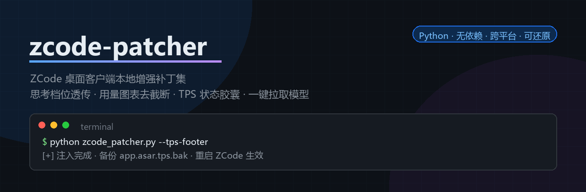

# zcode-patcher



> ZCode 桌面客户端本地增强补丁集：让自定义模型的思考档位真正生效、解锁完整用量图表、加一枚实时 TPS 状态胶囊、在设置页带来「一键拉取模型」按钮。
> 纯 Python（仅标准库）· 跨平台 · 全部可检查 / 可一键还原 · ZCode 升级后重打即可。

*Unofficial local enhancement patches for the ZCode desktop client: real reasoning-effort passthrough for custom models, untruncated usage charts, a live TPS status pill, and one-click model pulling in settings.*

> **非官方项目**，与 ZCode（智谱）官方无任何关联。本仓库不包含 ZCode 的任何代码或资源，所有改动均在本地对已安装的客户端打补丁，随时可还原。

> **来源说明**：本项目是两份社区作品的**整合与优化**，不是从零原创——初版 `zcode-patcher`（思考等级补丁 / TPS 状态栏 / Skill 框架）来自 [linux.do · lanvv 的分享帖](https://linux.do/t/topic/2886711)，模型拉取按钮来自 [HHQ-666/zcode-model-puller](https://github.com/HHQ-666/zcode-model-puller)。详见文末 [致谢与来源](#致谢与来源)。

---

## 功能一览

| # | 补丁 | 效果 | 命令 |
|---|------|------|------|
| 1 | **思考等级透传** | 自定义模型（内核白名单之外）的档位真正下发到请求体：anthropic 协议发 `budget_tokens`，OpenAI 兼容发 `reasoning_effort` 原名。内核补丁惰性兜底，白名单模型行为零变化 | `python scripts/zcode_patcher.py` |
| 2 | **用量页去截断** | 「设置 → 用量」趋势图不再只画 Top 6、饼图不再只画 Top 5 + 「其他模型」，全部模型完整展示 | `--usage-chart` |
| 3 | **TPS 状态栏** | 输入框工具栏常驻统计胶囊：`● 21:03 · 首 token 37s · 32 tok/s · out 1.7k`——当前会话最近一轮，流式中实时刷新，切换会话即消失，无常驻服务 | `--tps-footer` |
| 4 | **模型弹窗加宽** | 模型选择浮窗（含渠道二级菜单）192px → 320px，长模型名不再被截断成 `cn:deepseek-…` | `--model-width` |
| 5 | **模型拉取按钮** | 设置页「⚡️ 自动拉取模型」：从供应商 `/models` 拉取模型列表，勾选即写入配置；**新增供应商一步到位**（自动建条目）；元数据感知（上下文 / 输出上限 / 思考档位按服务器真实值写入） | `--model-puller` |
| 6 | **CLI 拉模型** | 不动客户端，直接同步 `config.json`；`--refresh` 按服务器元数据刷新已有模型的 limit 与档位 | `python scripts/model_pull.py --all` |

## 快速开始

要求：[Python](https://www.python.org/) ≥ 3.10（脚本只用标准库，无需安装任何依赖）。

```bash
git clone https://github.com/linguo2625469/zcode-patcher.git
cd zcode-patcher

# 只读检查（可放心先跑）
python scripts/zcode_patcher.py --check
python scripts/zcode_patcher.py --usage-chart --check
python scripts/zcode_patcher.py --model-width --check
python scripts/zcode_patcher.py --tps-footer --check
python scripts/zcode_patcher.py --model-puller --check

# 打补丁（可单打，也可组合）
python scripts/zcode_patcher.py                  # ① 思考等级透传（内核）
python scripts/zcode_patcher.py --usage-chart    # ② 用量图表去截断
python scripts/zcode_patcher.py --model-width    # ③ 模型弹窗加宽
python scripts/zcode_patcher.py --tps-footer     # ④ TPS 状态栏
python scripts/zcode_patcher.py --model-puller   # ④ 模型拉取按钮
```

打完补丁**完全退出并重启 ZCode** 生效。安装位置自动探测（运行中进程 → 注册表 → 常见目录），也可显式指定：

```bash
python scripts/zcode_patcher.py "/Applications/ZCode.app"     # macOS
python scripts/zcode_patcher.py "D:\ZCode"                    # Windows
```

### 还原（随时可退）

```bash
python scripts/zcode_patcher.py --revert                   # 还原思考等级
python scripts/zcode_patcher.py --usage-chart --revert     # 还原用量图表
python scripts/zcode_patcher.py --model-width --revert     # 还原模型弹窗宽度
python scripts/zcode_patcher.py --tps-footer --revert      # 还原 TPS 状态栏
python scripts/zcode_patcher.py --model-puller --revert    # 还原模型拉取按钮
```

每个补丁首次执行时自动生成整包备份（`.bak`）与逐字节记录（sidecar json），还原精确到字节。

## 思考等级怎么用

ZCode 的档位选择器对"非内核白名单"的自定义模型能选中档位，但参数不会下发到请求体——本补丁在内核取参处加惰性兜底，按档位名现场合成参数。

**1）在 `~/.zcode/v2/config.json` 给模型配档位**（先完全退出 ZCode）：

```json
"reasoning": { "enabled": true, "variants": ["low", "high", "max"], "defaultVariant": "max" }
```

档位名任意（`variants` 里写什么，UI 就显示什么）。**手改 config 建议同时给该条目 `"zcode": {"modified": true}`**（防目录同步覆盖；走 UI 添加的模型客户端会自动带此标记）。

**2）档位 → 请求参数映射**（补丁内置，可在脚本 `HELPER` 中修改）：

| 档名 | anthropic `budget_tokens` | OpenAI 兼容 `reasoning_effort` |
|---|---|---|
| low / medium / high | 4000 / 8000 / 16000 | 同名透传 |
| xhigh / max | 32000 / 32000 | 原名透传 |
| 其它任意名 | 16000 兜底 | 不带 |
| off / none / disabled | 关闭 thinking | `"off"` |

**3）验证**：以供应商后台的请求日志为准（本地 rollout 日志脱敏，`thinking` 字段会被剥掉）。

## 平台支持

| 平台 | 支持 | 备注 |
|---|---|---|
| Windows | ✅ 实测 | 打 asar 补丁前需完全退出 ZCode（运行中会锁定文件）；Program Files 下需管理员终端 |
| macOS | ✅ 逻辑支持 | 修改 `.app` 会破坏代码签名，若启动异常：`sudo codesign --force --deep --sign - /Applications/ZCode.app`；`/Applications` 下需 sudo |
| Linux | ✅ 逻辑支持 | 探测 `/opt`、`/usr/share` |

开发与实测基于 **ZCode 3.11.2（Windows）**。对未知版本/未知结构，脚本一律拒绝盲改并报告原因，不会写坏文件；内核补丁在版本升级后可用 `--extract` 自动提取新锚点。

## 工作原理（简述）

- **asar 补丁**：直接解析 `app.asar` 头（不依赖任何 Node/asar 工具），区分两种手法——同长度字节级原地覆盖（用量图表），与保留 unpacked 原生模块的精确重打包（TPS、拉取按钮，改动条目重算 SHA256 integrity，写临时文件回读校验后原子替换）
- **内核补丁**：`zcode.cjs` 是 esbuild 压缩产物、符号名随版本重排；按「完整函数原文」做多版本锚点匹配，恰好唯一命中才动手，新版本可 `--extract` 按结构特征自动提取锚点
- **注入脚本**：renderer 脚本 + preload IPC 桥 + main handler；锚点用语义字符串（IPC 通道名等非压缩符号）配正则捕获压缩别名，跨版本存活
- **全部补丁**：幂等、`--check` 可查、`--revert` 可精确还原、多个补丁互不干扰

## 仓库结构

```
SKILL.md                        # ZCode Skill 定义（AI 代执行流程 + 逆向分析笔记）
scripts/zcode_patcher.py        # 主工具：五个补丁（思考等级 / 用量图表 / 弹窗加宽 / TPS / 拉取按钮）
scripts/model_pull.py           # CLI：拉取模型、按服务器元数据刷新已有模型
scripts/zcode-tps.js            # TPS 状态栏注入脚本
scripts/zcode-model-puller.js   # 模型拉取按钮注入脚本（含 preload/main 注入的配套设计）
scripts/tap_proxy.py            # 请求捕获代理：打印 ZCode 真实发出的请求体（验证思考档位等参数是否生效）
```

## 作为 ZCode Skill 使用

把整个目录放进 `~/.zcode/skills/zcode-patcher/`，ZCode 的 AI 会按 `SKILL.md` 的流程代执行（含只读核实、备份确认、还原命令展示等安全步骤）。

## 致谢与来源

本项目为两份社区作品的**整合与优化**，基础代码与思路均来自社区：

- **[linux.do · 这样的 zcode 太酷辣！（加个状态栏）](https://linux.do/t/topic/2886711)** — 作者 **lanvv**（2026-09-10）。本项目最初版本的来源：思考等级透传补丁、TPS 状态栏前端脚本（`scripts/zcode-tps.js`）、以及 Skill 的整体框架与流程设计。原帖明确 "可以直接借鉴定制你自己的状态"。
- **[HHQ-666/zcode-model-puller](https://github.com/HHQ-666/zcode-model-puller)**（MIT License, (c) HHQ-666）— 模型拉取按钮的前端脚本（`scripts/zcode-model-puller.js`，文件头保留原授权署名）与整体思路。

我们在两者基础上做的整合与优化：

| 方向 | 具体改造 |
|---|---|
| 打包内核 | 统一为纯 Python 实现：解析/重打包 asar 不依赖 Node，保留 unpacked 原生模块，重算 SHA256 integrity，写临时文件回读校验后原子替换 |
| 跨平台 | Windows / macOS / Linux 安装位置自动探测（原版分别写死 Windows 路径或 macOS `.app`） |
| 跨版本 | 内核锚点多版本匹配 + `--extract` 按结构特征自动提取；注入锚点改用语义字符串配正则捕获压缩别名，版本升级不失效 |
| 可靠性 | 全外科手术式还原（不依赖整包备份、多补丁共存互不误伤）、幂等、`--check` 可查、脚本热更新 |
| 模型拉取 | 自动创建供应商（破解客户端"先有模型才能存供应商"死锁）、API 协议判定、元数据感知模板（真实上下文 / 输出上限 / 思考档位）、React 表单兼容修复 |
| 新增 | CLI 版 `model_pull.py`（`--all/--provider/--dry-run/--refresh/--test`）、思考等级与网关的档位联动（原名透传、off 语义） |

## 免责声明

本项目仅供学习交流与个人本机使用。请遵守 ZCode 软件许可协议；因使用本工具产生的一切后果由使用者自行承担。补丁会随客户端升级失效，升级后重打即可。

## License

[MIT](LICENSE)
